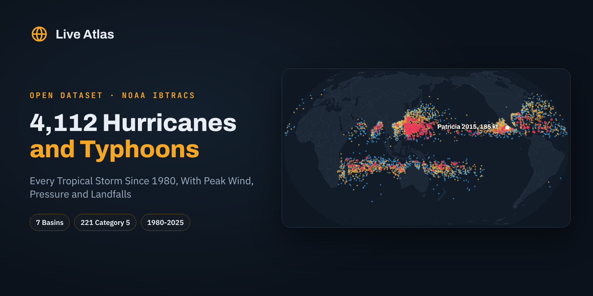

# Hurricanes, Typhoons And Tropical Cyclones 1980-2025



**English first, version française plus bas, resumen en español al final.**

## 4,112 Hurricanes, Typhoons and Cyclones Since 1980, One Row Per Storm

IBTrACS, the international best track archive, holds every 3 hourly position of every tropical cyclone, more than 100 megabytes of text. Most questions need one line per storm. This dataset turns the 1980 to 2025 archive into **4,112 storms**, each with its basin, start and end, peak wind in knots and mph, lowest pressure, peak Saffir-Simpson category and where the peak happened.

It adds the **landfalls at hurricane strength**, placed in their country, and a summary per ocean basin. The same storms are drawn on the [Live Atlas storm map](https://www.liveatlas.earth/cyclones/).

### The Headline Numbers

|  |  |
|---|---|
| Tropical storms or stronger, 1980 to 2025 | 4,112, about 89 a year |
| Reached hurricane or typhoon strength | 2,180 |
| Major, Category 3 or more | 1,105 |
| Category 5 | 221 |
| Busiest basin | Western Pacific, 1,181 storms and 123 Category 5 |
| Strongest wind | Patricia 2015, 185 kt (213 mph), 872 hPa |

The Western Pacific makes more than a quarter of the world's tropical cyclones and more than half of its Category 5 storms. The North Atlantic, the basin the US watches, makes about 14 storms a year, fewer than the Eastern Pacific off Mexico, whose storms mostly die at sea.

### Files

| file | content |
|---|---|
| `data/tropical_cyclones_1980_2025.csv` | 4,112 rows, one per storm |
| `data/hurricane_force_landfalls_1980_2025.csv` | One row per landfall at 64 kt or more, with country |
| `data/storms_by_basin_1980_2025.csv` | 7 rows, one per basin |
| `data/us_hurricane_landfalls_by_state_1980_2025.csv` | Hurricanes and major hurricanes that made landfall in each US state |
| `images/cover.png` | Cover image, 1600 × 800 |

### Columns

**tropical_cyclones_1980_2025.csv**

| column | description |
|---|---|
| `sid` | IBTrACS storm id |
| `name` | Storm name, Unnamed when none |
| `season` | Season year |
| `basin` | Basin of formation |
| `basins_crossed` | Every basin the storm entered |
| `start_time_utc` | First track point |
| `end_time_utc` | Last track point |
| `genesis_latitude` | Latitude of the first point |
| `genesis_longitude` | Longitude of the first point |
| `max_wind_kt` | Highest sustained wind, knots (US agencies when available, else WMO agency) |
| `max_wind_mph` | Same in mph |
| `min_pressure_hpa` | Lowest central pressure, hPa |
| `peak_category` | Saffir-Simpson category at peak |
| `peak_time_utc` | Time of peak wind |
| `peak_latitude` | Latitude at peak |
| `peak_longitude` | Longitude at peak |
| `track_points` | Number of track points |

**hurricane_force_landfalls_1980_2025.csv**

| column | description |
|---|---|
| `sid` | IBTrACS storm id |
| `name` | Storm name |
| `season` | Season |
| `time_utc` | First track point over land |
| `country` | Country of landfall |
| `country_iso3` | ISO 3166 alpha-3 |
| `latitude` | Latitude |
| `longitude` | Longitude |
| `wind_kt` | Sustained wind at that point, knots |
| `category_at_landfall` | Saffir-Simpson category at that point |

### Load It

```python
import pandas as pd

df = pd.read_csv("https://raw.githubusercontent.com/liveatlasearth/tropical-cyclones-1980-2025/main/data/tropical_cyclones_1980_2025.csv")
df.groupby(["basin", "peak_category"]).size().unstack(fill_value=0)
```

### How It Was Built

Built from the IBTrACS v04r01 `since1980` CSV, downloaded on 30 October 2026. A storm is kept when its peak sustained wind reached 34 kt, using `USA_WIND` (1 minute winds) when present and `WMO_WIND` otherwise. Categories follow the Saffir-Simpson thresholds on that wind. A landfall is the first track point with `DIST2LAND` equal to 0 after a point over water, at 64 kt or more, placed in a country with Natural Earth boundaries. US landfalls by state come from the NHC HURDAT2 landfall records.

### Checked Against The Source

Counts per basin and the 221 Category 5 storms match the Live Atlas analysis of the full IBTrACS file within five storms, and Patricia 2015 matches its official record (185 kt, 872 hPa). US landfalls by state were recounted from HURDAT2.

### Read With Care

- **Wind averaging differs by agency.** Outside US basins, `WMO_WIND` is often a 10 minute average, which runs about 12% lower than a 1 minute wind, so some storms look weaker than their US equivalent.
- **Satellite era only.** Starting in 1980 keeps the record consistent, but early 1980s intensities in the Indian Ocean are less reliable.
- **Landfalls use 3 hourly points**, so a storm that brushed a coast between two points can be missed.

### License And Citation

**[CC BY 4.0](https://creativecommons.org/licenses/by/4.0/)**. Use it, share it and adapt it, commercially or not, and credit **Live Atlas** with a link to **[liveatlas.earth](https://www.liveatlas.earth/)**, along with the original source below.

```bibtex
@misc{liveatlas_tropical_cyclones_1980_2025_2026,
  title  = {Hurricanes, Typhoons And Tropical Cyclones 1980-2025},
  author = {Ridge, Nathan and {Live Atlas}},
  year   = {2026},
  url    = {https://github.com/liveatlasearth/tropical-cyclones-1980-2025},
  note   = {Dataset, version 1.0, built from NOAA IBTrACS data}
}
```

Sources. Knapp, K. R., et al. (2010), The International Best Track Archive for Climate Stewardship (IBTrACS), BAMS 91, 363-376, doi:10.1175/2009BAMS2755.1, and Gahtan, J., et al. (2024), IBTrACS Version 4r01, NOAA NCEI, doi:10.25921/82ty-9e16. NHC HURDAT2. Natural Earth boundaries. Public domain sources.

Companion datasets, **[US Wildfires Over 1,000 Acres](https://github.com/liveatlasearth/us-wildfires-over-1000-acres)** ([Kaggle](https://www.kaggle.com/datasets/liveatlasearth/us-wildfires-over-1000-acres), [Hugging Face](https://huggingface.co/datasets/liveatlasearth/us-wildfires-over-1000-acres)), **[INFORM Risk Index 2026 By Country](https://github.com/liveatlasearth/inform-risk-index-2026)** ([Kaggle](https://www.kaggle.com/datasets/liveatlasearth/inform-risk-index-2026), [Hugging Face](https://huggingface.co/datasets/liveatlasearth/inform-risk-index-2026)), **[Tsunamis Since 1900](https://github.com/liveatlasearth/tsunamis-since-1900)** ([Kaggle](https://www.kaggle.com/datasets/liveatlasearth/tsunamis-since-1900), [Hugging Face](https://huggingface.co/datasets/liveatlasearth/tsunamis-since-1900)).

Also on **[Kaggle](https://www.kaggle.com/datasets/liveatlasearth/tropical-cyclones-1980-2025)**, with a starter notebook, and on **[Hugging Face](https://huggingface.co/datasets/liveatlasearth/tropical-cyclones-1980-2025)**, ready for the `datasets` library.

See every storm track since 1950 on **[Live Atlas](https://www.liveatlas.earth/cyclones/)**.

---

## Version Française

### Ouragans, Typhons Et Cyclones De 1980 à 2025

Les archives IBTrACS donnent toutes les positions de tous les cyclones tropicaux, toutes les 3 heures. Ce jeu de données en tire **4 112 tempêtes**, une par ligne, avec le bassin, les dates, le vent maximal en nœuds et en mph, la pression minimale, la catégorie Saffir-Simpson au pic, les atterrissages en force d'ouragan par pays et un résumé par bassin.

- 221 tempêtes ont atteint la catégorie 5 depuis 1980, dont 123 dans le Pacifique ouest.
- Le record de vent reste Patricia en 2015, avec 185 nœuds (341 km/h) et 872 hPa.
- Hors bassins américains, le vent est souvent moyenné sur 10 minutes, ce qui donne des valeurs plus basses.

Licence CC BY 4.0, en citant **Live Atlas** avec un lien vers **[liveatlas.earth](https://www.liveatlas.earth/)** et la source d'origine.

### 🇪🇸 Resumen

4.112 huracanes, tifones y ciclones tropicales de 1980 a 2025, una fila por tormenta, con viento máximo, presión mínima, categoría y llegadas a tierra, a partir de IBTrACS de la NOAA. Licencia CC BY 4.0.

---

**Part of [Natural Hazards Datasets](https://github.com/liveatlasearth/natural-hazards-datasets)**, open data on earthquakes, volcanoes, storms, fires and space weather. Data by [Live Atlas](https://www.liveatlas.earth/), the free live map of the planet's hazards.
